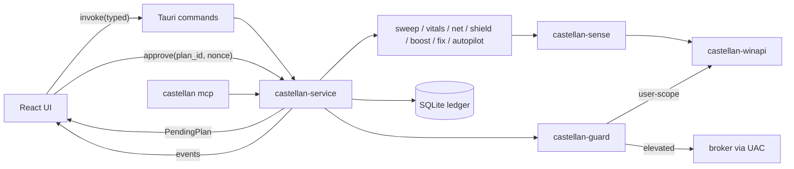

# CASTELLAN DESKTOP — Master Plan da Versão Gráfica

> **Para quem é este documento:** para a LLM orquestradora (e as sessões que ela abrir) que vai construir o **Castellan Desktop**: a versão gráfica, completa e definitiva do Castellan.
> **Quem planejou:** as decisões de produto, marca, arquitetura, segurança e qualidade já estão tomadas aqui. Você executa. Onde o plano for omisso, decida com critério, registre em um ADR (`docs/adr/`) e siga.
> **Dono e autor:** **Denner Parreiras** — GitHub [`@dennerparreiras`](https://github.com/dennerparreiras). Todo o trabalho é creditado a ele.
> **Idioma:** este plano está em português. **O produto é em inglês** (código, commits, docs, textos da interface), com pt-BR como segunda língua via i18n desde o primeiro dia.
> **Documento irmão:** `CASTELLAN_MASTER_PLAN.md` (o "Plano 1"). Ele continua sendo a **especificação funcional e de segurança**. Este plano diz **como entregar tudo aquilo numa interface gráfica de nível mundial** e **muda a definição de pronto**: nada fica "em breve".

---

## Sumário

0. Missão em uma página
1. A regra que muda tudo: todas as funcionalidades funcionando
2. Mentalidade e protocolo de trabalho
3. Orquestração: orquestrador + sessões Opus 5.5 em paralelo
4. Ponto de partida: o que já existe no repositório
5. Stack da versão gráfica
6. Arquitetura
7. Segurança da versão gráfica
8. Marca: identidade, logo, cor, tipografia, voz
9. Design system
10. Movimento e efeitos
11. Janela e integração com o Windows
12. Telas — especificação completa
13. Backend: completar todos os módulos
14. Matriz de aceite de funcionalidades
15. Paridade entre GUI, CLI, TUI e MCP
16. Testes e qualidade
17. Performance
18. Empacotamento, instalação, atualização
19. Documentação
20. Roadmap por marcos
21. Definition of Done
22. Proibições absolutas
23. Autonomia e decisões do dono

---

## 0. Missão em uma página

Construir o **Castellan Desktop**: um aplicativo gráfico para Windows 10/11, com visual **futurista, elegante e marcante**, que entrega **100% das funcionalidades** do Plano 1, funcionando de verdade, com segurança de nível profissional:

- **Limpa** (temporários, caches, lixeira, Windows.old) pelo núcleo de segurança, com prévia, confirmação, progresso real e registro.
- **Diagnostica** hardware, disco (SMART), memória, estabilidade, inicialização, drivers, atualizações, rede e segurança, com um Keep Score explicável.
- **Protege**: auditoria de postura, explorador de persistência com assinaturas, endurecimento em perfis, sempre reversível.
- **Acelera**: gerenciador de inicialização, "por que está lento agora", energia, efeitos visuais, **modo jogo** com reversão automática.
- **Repara**: playbooks guiados (DISM/SFC, chkdsk, áudio, rede, Windows Update, Explorer, impressão, Store, hora).
- **Cuida sozinho**: Morning Round na inicialização, Weekly Deep Round, notificações discretas.
- **Lembra e desfaz**: Ledger com hash encadeado, diff antes/depois, undo.
- **Conversa com LLMs** via MCP, com fila de aprovação humana dentro da própria GUI.
- **Instala por linha de comando** e também por instalador assinado; inicia com o Windows (a rotina, não a janela).

E com uma **identidade visual própria**: logo, marca, sistema de design, animações com propósito, um "núcleo" de saúde vivo, gráficos em tempo real, visualizações de rede e disco que dão vontade de mostrar para os outros — **mais bonito que a versão CLI**, que já é bonita.

**Sucesso:** o Denner instala com um comando, reinicia, e o PC se mantém sozinho. Quando abre o Castellan, vê em dois segundos a saúde da máquina numa tela linda, entende cada número, e cada botão faz exatamente o que diz, explica antes, e pode ser desfeito.

---

## 1. A regra que muda tudo: todas as funcionalidades funcionando

O Plano 1 permitia entregar por marcos e mostrar salas "ainda não construídas". **Este plano não permite isso no release.** A versão gráfica só está pronta quando:

1. **Toda funcionalidade listada no Plano 1 §8 (8.1 a 8.10), §12 (comandos), §13 (MCP) e §15 (instalação/arranque/update/desinstalação) funciona de ponta a ponta**, acessível pela GUI, testada, documentada.
2. **Nenhuma tela, botão, aba ou menu do produto final diz "coming later", "not built", "preview" ou equivalente.** A única exceção é recurso que **depende de hardware ausente** (ex.: bateria num desktop, Wi-Fi sem adaptador, sensor sem API em modo usuário). Nesses casos a tela diz por que não se aplica àquela máquina — isso é honestidade, não falta de funcionalidade.
3. **"Funcionando perfeitamente" tem definição operacional:** cada funcionalidade tem uma linha na Matriz de Aceite (§14) com o teste que prova que funciona e onde ele roda. Linha sem teste verde = funcionalidade não entregue.
4. **As regras de segurança do Plano 1 continuam valendo integralmente** (§7 e §23 dele). "Funcionar" nunca significa relaxar uma trava. Uma funcionalidade que só funciona desligando uma trava está **errada** e volta para o desenho.
5. **Ações reais só rodam fora da máquina de desenvolvimento** (ver §2.3). Funcionar de verdade é provado em VMs/runners descartáveis e, no fim, validado pelo dono na máquina dele.

Durante o desenvolvimento, telas podem existir antes do backend — mas **apenas atrás de fixtures de desenvolvimento** (Storybook/Playwright com IPC simulado). O build de produção **não contém** fixtures (um teste verifica isso no bundle).

---

## 2. Mentalidade e protocolo de trabalho

### 2.1 Herdado do Plano 1

Leia o Plano 1 §1 inteiro e aplique: dê o seu melhor sem economizar tokens; não entregue esqueleto; não finja; verifique em vez de presumir; o protocolo de reflexão de 7 perguntas a cada unidade de trabalho. **Não é opcional.**

### 2.2 Protocolo de reflexão visual (novo)

A GUI é julgada com os olhos. Para toda mudança visual:

1. **Gere capturas** (Playwright, §16.4) da tela em 1280×800, 1920×1080 e 2560×1440, nos temas escuro e claro, e em modo alto contraste.
2. **Olhe as capturas** (você é multimodal — use isso). Não aprove pelo código.
3. Responda por escrito: *Está alinhado à grade? O contraste passa WCAG AA? A hierarquia está clara em 3 segundos? Existe algo que um designer sênior mudaria? Alguma animação existe sem propósito? Algum número na tela não foi medido?*
4. Compare com o brand book (§8) e o design system (§9). Divergiu? Corrija ou justifique em ADR.
5. Anexe as capturas ao PR.

### 2.3 A máquina de desenvolvimento é a máquina do dono

Igual ao Plano 1 §1.4, e com ênfase porque agora tudo vai funcionar de verdade:

- **Nunca** execute limpeza real, flush de DNS, reset de rede, alteração de registro, serviço, plano de energia, tarefa agendada, hardening, playbook de reparo ou instalação **na máquina do Denner**. Nem "só para testar".
- Toda operação mutável recebe raiz/alvo injetável. Testes usam diretórios temporários, hive de registro de teste e *fakes* das APIs de sistema.
- Ações reais são exercitadas **apenas** em: runners Windows descartáveis do CI, VMs Hyper-V/Windows Sandbox descartáveis, ou pelo próprio dono.
- Leituras (diagnóstico) podem rodar na máquina do dono — elas não mudam nada. Mesmo assim: nada de varreduras pesadas repetidas, nada de speed test sem o dono pedir.
- Builds de debug continuam recusando mutações reais sem `CASTELLAN_ALLOW_REAL_SYSTEM=1`. **Você não define essa variável na máquina do dono.** Nunca.

### 2.4 Qualidade de produto premium

Este é o cartão de visita do Denner. Trate como um produto de empresa grande: cada pixel alinhado, cada texto revisado, cada estado (carregando, vazio, erro, parcial, sem permissão, offline) desenhado, cada animação a 60 fps, cada interação com teclado, cada tela legível por leitor de tela.

---

## 3. Orquestração: orquestrador + sessões Opus 5.5 em paralelo

O projeto é grande demais para uma linha só. Trabalhe com **uma sessão orquestradora** e **várias sessões executoras em paralelo**. Se o seu ambiente permite abrir sessões (por exemplo, sessões do Claude Code com o modelo **Opus 5.5**, cada uma em seu próprio *git worktree*), use isso. Se não permite, use subagentes com o mesmo recorte.

### 3.1 Papel da sessão orquestradora

- Única que: altera contratos públicos (`castellan-core`, `castellan-service`, contrato IPC), funde na `main`, cria tags e releases, mexe em `.github/`, `packaging/` e configuração do repositório.
- Mantém `docs/dev/STATUS.md` e `docs/dev/SESSIONS.md` (quem está em quê, branch, worktree, bloqueios).
- Escreve o **brief** de cada sessão: objetivo, seções deste plano e do Plano 1 a ler, arquivos/crates de posse, contrato de entrada e saída, critérios de aceite (linhas da Matriz §14), comandos de verificação, o que já foi descartado.
- **Revisa todo PR** lendo o diff inteiro e rodando os gates. Relato de sessão é alegação, não prova.
- Garante que **duas sessões nunca escrevem nos mesmos arquivos**. Mudança em contrato compartilhado passa por ela.

### 3.2 Regras para as sessões executoras

- Uma sessão = uma área com dono claro = um worktree = uma branch (`feat/<área>-<tema>`).
- Sessão não funde na `main`. Abre PR, roda `cargo xtask ci` + gates do frontend, anexa evidências (saídas, capturas).
- Sessão que precisar mudar um contrato **para** e pede ao orquestrador.
- Toda sessão segue §2 (reflexão, reflexão visual, máquina do dono).
- Recomendado: no máximo **5 sessões executoras simultâneas**. Mais que isso gera mais custo de integração do que ganho.

### 3.3 Trilhas e ondas

| Onda | Trilhas em paralelo (uma sessão cada) | Depende de |
|---|---|---|
| **W0** (serial, orquestrador) | ADRs 0007–0012, extração de `castellan-sense` e `castellan-service`, contrato IPC v1, esqueleto `apps/desktop` compilando, CI do frontend | — |
| **W1** | (a) Marca e brand book · (b) Design system + tokens compartilhados GUI/TUI · (c) Shell da janela (Mica, titlebar, tray, single instance, roteamento) · (d) `castellan-store` SQLite + Ledger + undo · (e) Broker elevado + IPC + tarefas agendadas | W0 |
| **W2** | (a) Sweep completo + Disk Lens · (b) Vitals completo (SMART, Event Log, drivers, updates) · (c) Net completo · (d) Shield completo · (e) Telas Overview + Keep Core + Command Palette | W1 |
| **W3** | (a) Boost + Game · (b) Fix (playbooks + parsers) · (c) Autopilot + notificações + Chronicle · (d) MCP + fila de aprovação na GUI · (e) Telas Sweep/Vitals/Network/Shield | W2 |
| **W4** | (a) Telas Boost/Game/Fix/Autopilot/Ledger/Reports/Settings/MCP/About · (b) Onboarding + instalador + updater + desinstalação · (c) i18n pt-BR completo · (d) Paridade CLI/TUI · (e) Documentação e capturas | W3 |
| **W5** (orquestrador + revisores) | Endurecimento, auditoria de segurança, auditoria visual, performance, release candidate, validação pelo dono | W4 |

### 3.4 Revisores permanentes (a cada onda)

Os cinco do Plano 1 §2.3 (Security Reviewer, Adversarial Tester, UX Critic, Docs Verifier, Snake-Oil Auditor) e mais dois:

| Revisor | Missão |
|---|---|
| **Art Director** | Olha todas as capturas da onda contra o brand book. Reprova o que estiver genérico, desalinhado, com contraste ruim ou "cara de template". |
| **WebView Attacker** | Tenta, a partir do frontend, executar algo que não deveria: comando IPC não autorizado, plano forjado, navegação externa, injeção via strings do sistema renderizadas como HTML, abuso de `opener`. |

Dê aos revisores **o código e as capturas**, não a sua conclusão.

---

## 4. Ponto de partida: o que já existe no repositório

Leia antes de começar (não confie neste resumo; confirme no código):

- Workspace Rust 2024, toolchain fixada (`rust-toolchain.toml`), gate `cargo xtask ci` (fmt, clippy `-D warnings`, testes, varredura de arquitetura: `unsafe` só em `castellan-winapi`, sem `cmd /c`/`cmd.exe`/`Win32_Product`, funções destrutivas `guard_*` só chamadas pelo guard).
- `castellan-core`: tipos, `Action`, política, Keep Score, persona.
- `castellan-winapi`: wrappers seguros (pastas conhecidas, espaço livre, memória, CPU, uptime, discos fixos, abertura sem seguir reparse point, deleção por handle com `GuardToken`, flush de DNS por caminho absoluto).
- `castellan-guard`: decisão por nó, deny-list, sweep em memória, medição somente leitura (`measure_no_follow`).
- `castellan-store`: ledger append-only inicial.
- `castellan-engine`: volume → finding → score.
- `castellan-tui`: TUI redesenhada (salas, tema Keep, gráficos ao vivo, galeria `--example gallery`).
- `castellan-cli`: binário `castellan`, coleta de leituras ao vivo, preferências.
- ADRs 0001–0006; docs em `docs/`; CI em `.github/workflows/ci.yml` e `security.yml`.

**O que falta** é quase todo o Plano 1 §8 em modo real, o broker elevado, o SQLite, o MCP, o instalador — e a GUI inteira.

---

## 5. Stack da versão gráfica

### 5.1 Decisão: **Tauri 2 + frontend web (React + TypeScript)**, backend Rust reaproveitando o workspace

Registre em `docs/adr/0007-desktop-stack.md`. Justificativa:

- **Reaproveita 100% do Rust existente**: o backend da GUI é o mesmo workspace; o Safety Kernel, o score e as coletas são os mesmos da CLI.
- **O melhor teto visual possível**: CSS moderno, WebGL2 para shaders, Canvas para gráficos a 60 fps, SVG para a marca, tipografia de verdade, acessibilidade (ARIA funciona com leitores de tela, o que a TUI não oferece).
- **Leve comparado a Electron**: usa o WebView2 do sistema (presente no Windows 11; instalável no 10), binário de poucos MB.
- **Modelo de segurança explícito**: capabilities por janela, comandos tipados, CSP, padrão de isolamento.
- **Alternativas descartadas** (registre no ADR): Electron (pesado, Node no processo, superfície enorme); Slint (ótimo nativo, mas teto visual/efeitos e ecossistema menores); egui/wgpu (imediato, acessibilidade fraca, acabamento caro); WinUI 3 via windows-rs (suporte Rust imaturo, tooling instável); Flutter (segundo runtime e segunda linguagem sem ganho).

### 5.2 Bibliotecas (verifique versão estável e manutenção **no momento da execução**; não confie na memória)

| Área | Escolha | Observação |
|---|---|---|
| Shell | `tauri` 2.x | Plugins só os listados abaixo. |
| Plugins Tauri | `single-instance`, `notification`, `updater`, `window-state`, `opener` (escopo restrito), `autostart` **não** (a inicialização é a tarefa agendada) | Nada de `shell`, `fs`, `http`, `process` expostos ao frontend. |
| Tipos IPC | `specta` + `tauri-specta` (gera bindings TS dos comandos e eventos) | Se estiver instável na hora, use `ts-rs` + wrappers escritos à mão e um teste de contrato que compara. ADR. |
| UI | React 19 + TypeScript `strict` | Sem `any`. ESLint + Prettier. |
| Build | Vite | Saída estática servida pelo protocolo interno do Tauri. |
| Estilo | Tailwind CSS 4 + CSS variables geradas dos tokens | Tokens são a fonte da verdade, não classes soltas. |
| Primitivos acessíveis | Radix UI (ou React Aria) | Diálogos, menus, tooltips, tabs, toggles com teclado e ARIA corretos. |
| Animação | Motion (antigo Framer Motion) | Layout animations, springs, gestos. |
| Shaders | WebGL2 puro ou OGL (minúsculo) | Fundo "aurora", brilho do Keep Core. Sem three.js salvo necessidade real (ADR). |
| Gráficos | uPlot (séries temporais rápidas) + Canvas/SVG próprios | Treemap do Disk Lens e rota de rede são componentes próprios. |
| Dados | TanStack Query (comandos) + Zustand (estado de UI e streams de eventos) | |
| Rotas | TanStack Router (tipado) | |
| Ícones | Lucide (ISC) + ícones próprios da marca | Ícones da marca desenhados em SVG no repo. |
| Fontes | Space Grotesk (display), Inter (UI), JetBrains Mono (números) — todas OFL, **empacotadas localmente** | Nunca Google Fonts CDN: o app não acessa a rede sem pedir. Confirme as licenças e inclua `OFL.txt`. |
| i18n | Fluent (`@fluent/react` no front, `fluent` no Rust), **catálogos compartilhados** em `i18n/` | en-US e pt-BR. |
| Testes front | Vitest, Testing Library, Playwright, `@axe-core/playwright` | |
| E2E app real | WebdriverIO + `tauri-driver` (msedgedriver) no Windows | Confirme o suporte atual; ADR. |
| Gerenciador de pacotes | pnpm, lockfile versionado | Bloquear scripts de instalação de dependências (`onlyBuiltDependencies` só com o necessário). |

**Regra de dependências do frontend:** o mínimo. Toda dependência nova justificada no PR (o que faz, tamanho, licença, manutenção, alternativa). `pnpm audit` e licenças no CI. Nada que carregue código remoto, analytics, fontes remotas ou CDNs.

---

## 6. Arquitetura

### 6.1 Estrutura do repositório (alvo)

```
castellan/
├─ crates/
│  ├─ castellan-core/        # domínio puro (existe)
│  ├─ castellan-winapi/      # único unsafe (existe, cresce)
│  ├─ castellan-guard/       # Safety Kernel (existe, completa)
│  ├─ castellan-store/       # SQLite: histórico, ledger com hash encadeado, undo (cresce)
│  ├─ castellan-sense/       # NOVO: coletas somente leitura (fatos, pulso, medições) extraídas do CLI
│  ├─ castellan-engine/      # probes → findings → score (cresce)
│  ├─ castellan-sweep/       # NOVO (Plano 1 §8.1)
│  ├─ castellan-vitals/      # NOVO (§8.2)
│  ├─ castellan-net/         # NOVO (§8.3)
│  ├─ castellan-shield/      # NOVO (§8.4)
│  ├─ castellan-boost/       # NOVO (§8.5 + §8.6 game)
│  ├─ castellan-fix/         # NOVO (§8.7)
│  ├─ castellan-autopilot/   # NOVO (§8.8 + §8.9 chronicle)
│  ├─ castellan-report/      # NOVO (§8.10)
│  ├─ castellan-broker/      # NOVO: executor elevado + IPC (Plano 1 §6.3)
│  ├─ castellan-service/     # NOVO: a FACHADA. API única para GUI, CLI, TUI e MCP
│  ├─ castellan-mcp/         # NOVO (§13 do Plano 1)
│  ├─ castellan-tui/         # existe
│  └─ castellan-cli/         # existe; vira cliente fino do service
├─ apps/
│  └─ desktop/               # frontend React + TS + Vite (package.json, src/) — ADR 0007
│     └─ src-tauri/          # crate `castellan-desktop` (membro do workspace)
├─ design/
│  ├─ tokens.json            # fonte única de cor/espaço/raio/movimento → CSS e tema da TUI
│  └─ brand/                 # SVGs mestres da marca, ícones, guia
├─ i18n/                     # catálogos Fluent compartilhados (en-US, pt-BR)
├─ packaging/                # instalador, winget, scoop, install.ps1
├─ docs/
└─ xtask/
```

### 6.2 A fachada `castellan-service`

Um único ponto de entrada de alto nível, usado por **todos** os frontends:

```rust
pub struct Castellan { /* store, policy, engine, módulos, canal de eventos */ }

impl Castellan {
    // leitura
    pub async fn overview(&self) -> Overview;
    pub async fn inspect(&self, depth: Depth, pillars: &[Pillar]) -> InspectionStream;
    pub async fn sweep_scan(&self, targets: &[SweepTargetId]) -> ScanStream;
    pub async fn net_check(&self, depth: Depth) -> NetStream;
    // ... um método por capacidade do Plano 1 §8

    // planejamento (nunca muta)
    pub fn plan(&self, origin: Origin, request: PlanRequest) -> Result<PendingPlan, PlanError>;

    // execução (sempre via guard/broker)
    pub async fn approve_and_run(&self, plan: PlanId, approval: Approval) -> RunStream;
    pub async fn undo(&self, plan: PlanId, approval: Approval) -> RunStream;

    // eventos contínuos
    pub fn subscribe(&self) -> EventReceiver; // pulso, progresso, findings novos, planos pendentes do MCP
}
```

Regras:

- **Frontend nenhum monta uma `Action`.** Frontends pedem um `PlanRequest` com IDs do catálogo; o service monta e valida o plano; o frontend só aprova por `PlanId` + `Approval` (§7.3).
- Streams (`*Stream`) entregam resultados parciais, para a GUI preencher a tela conforme chegam.
- Toda a lógica de negócio fica no service e abaixo. `apps/desktop/src-tauri` só traduz service ⇄ IPC. (G0 entregou a fachada com chamadas bloqueantes executadas no pool do Tauri; ver ADR 0008.)
- O teste de arquitetura do `xtask` ganha regras: frontends (`castellan-cli`, `castellan-tui`, `castellan-mcp`, `castellan-desktop`) não dependem de módulos funcionais diretamente, só do service; `castellan-desktop` não depende de `castellan-winapi`.

### 6.3 Processos

| Processo | Privilégio | Papel |
|---|---|---|
| `Castellan.exe` (GUI) | Usuário (`asInvoker`) | Janela + tray. Lê, planeja, pede aprovação. |
| `castellan.exe broker` | Administrador, sob demanda via UAC | Executa lotes aprovados. Reaplica todo o Safety Kernel. Encerra ao terminar. |
| Tarefa agendada `\Castellan\Morning Round` | Administrador (modo máquina) | Rotina de logon, **sem janela**. Lê só a política da máquina. |
| `castellan.exe mcp serve` | Usuário, nunca elevado | Servidor MCP por stdio. Planos que ele cria aparecem na fila da GUI. |

A GUI **não** inicia com o Windows. Quem inicia é a rotina (headless). O ícone na bandeja pode ser habilitado pelo usuário (opt-in) e é um processo leve.

### 6.4 Contrato IPC

- Comandos Tauri finos, um por método do service, com tipos gerados para TypeScript (specta). O arquivo de bindings gerado é versionado e o CI falha se ficar desatualizado.
- Eventos com nomes estáveis (`pulse`, `inspection.progress`, `sweep.progress`, `plan.pending`, `run.progress`, `run.finished`, `finding.new`).
- Versão do contrato (`ipc_version`) checada na inicialização do frontend.
- Erros como tipos (código `CST-E…`, mensagem, dica), nunca strings soltas.

### 6.5 Fluxo de dados



---

## 7. Segurança da versão gráfica

Tudo do Plano 1 §7 continua. A GUI adiciona uma superfície nova: **o WebView**. Trate-o como **não confiável**: se um dia aparecer um XSS, ele não pode conseguir nada perigoso.

### 7.1 Configuração do Tauri (obrigatória)

- **Sem conteúdo remoto.** O frontend é servido apenas pelo protocolo interno. Nenhum `<iframe>`, nenhuma URL remota carregada na janela.
- **CSP estrita:** `default-src 'self'; script-src 'self'; style-src 'self'; img-src 'self' data:; font-src 'self'; connect-src ipc: http://ipc.localhost; object-src 'none'; base-uri 'none'; frame-ancestors 'none'` (ajuste ao que o Tauri exige; nada de `unsafe-eval`; `unsafe-inline` em estilo só se inevitável, com ADR).
- **Capabilities mínimas:** a janela principal recebe só os comandos do Castellan e as permissões estritamente necessárias dos plugins listados em §5.2. Nada de `shell`, `fs`, `http`, `process`.
- **Padrão de isolamento do Tauri** (isolation pattern) habilitado para interceptar e validar mensagens IPC.
- **`opener`** só para uma allowlist de URLs (`https://github.com/dennerparreiras/castellan*`, páginas de docs da Microsoft referenciadas por findings) e para "Mostrar no Explorer" de caminhos **que o backend devolveu** — nunca caminho vindo do frontend.
- **DevTools desabilitado** em release. Menu de contexto nativo desabilitado.
- **Navegação bloqueada:** qualquer tentativa de navegar a janela para fora do app é cancelada.

### 7.2 Comandos IPC

- Aceitam **apenas tipos fechados**: enums, IDs do catálogo, números com limites. **Nenhum comando aceita caminho, comando, chave de registro ou script livre para mutação.**
- Os poucos comandos que aceitam caminho (Disk Lens: "analisar esta pasta") são **somente leitura**, com validação, sem seguir reparse points, com limite de entradas e tempo.
- Rate limit e tamanho máximo de payload por comando.
- Todo comando que muta passa por `plan` → `approve_and_run`. Não existe atalho.

### 7.3 Aprovação de planos

- O service cria o plano e devolve `PlanId` + **nonce de uso único** + resumo legível + tier.
- A GUI mostra o plano (o que muda, por quê, como desfazer, estimativa) e coleta a aprovação conforme o tier (Plano 1 §7.3):
  - **Safe:** botão de confirmar.
  - **Moderate:** diálogo de confirmação com o plano.
  - **Sensitive:** plano detalhado + **segurar o botão por 1,5 s** (anel de progresso) **e** o UAC do Windows quando houver elevação. Ponto de restauração quando aplicável.
- O nonce expira em minutos e não é reutilizável; plano alterado após criado = rejeitado (hash do plano).
- **A confirmação da GUI nunca substitui o UAC.** Elevação só pelo broker.
- Planos criados via **MCP** entram numa **fila de aprovação** na GUI (tray badge + notificação). O usuário revisa e aprova lá. Sensitive vindo do MCP: a GUI mostra, mas exige o mesmo fluxo completo de Sensitive.

### 7.4 Renderização de dados não confiáveis

Nomes de processo, arquivo, tarefa, serviço, SSID, editor de assinatura, mensagens do Event Log: **sempre renderizados como texto** (React escapa por padrão). **Proibido** `dangerouslySetInnerHTML`, `innerHTML`, `eval`, `new Function`. Uma regra de lint e um teste de varredura do código garantem isso.

### 7.5 Outros

- Sem telemetria, sem analytics, sem crash reporting remoto. Crash dumps locais apenas, com opção de exportar.
- Atualização só com assinatura verificada (plugin `updater` com chave pública embutida) — e nunca silenciosa.
- Binários em `%ProgramFiles%` (ACL só admin) no modo máquina; a tarefa elevada recusa existir se o diretório for gravável por não-admin (Plano 1 §15.2).
- `SetDefaultDllDirectories` no início do processo da GUI, como na CLI.
- `docs/security/threat-model.md` ganha a seção **WebView/IPC** com STRIDE completo.

---

## 8. Marca: identidade, logo, cor, tipografia, voz

Crie `docs/brand/README.md` (o brand book) e `design/brand/` (arquivos mestres). Toda decisão abaixo vira página do brand book com exemplos de uso certo e errado.

### 8.1 Conceito

**"The keep, reimagined."** O castelo da TUI vira uma **cidadela cristalina**: geometria precisa, luz de energia correndo por arestas, vidro escuro. Não é castelo medieval de fantasia; é uma fortaleza de ficção científica sóbria — algo entre um painel de nave e um relógio suíço. **Futurista sem ser gamer-neon cafona; elegante sem ser corporativo genérico.**

Palavras-guia: *vigilante, preciso, calmo, luminoso, confiável.*
Palavras proibidas no visual: *caveira, raio exagerado, RGB arco-íris, "turbo", velocímetro de carro.*

### 8.2 Logo

**Símbolo — "The Crest":**

- Um **hexágono** de pontas para cima, desenhado com contorno de 2 unidades num grid de 24, com cantos levemente chanfrados.
- Dentro, a **torre**: três barras verticais com ameias no topo, a central mais alta. Leitura dupla proposital: **torre de castelo** e **gráfico de barras subindo** (saúde, medição).
- Na base da barra central, um entalhe que forma uma **fechadura** discreta (segurança, guarda).
- No vértice superior direito do hexágono, o contorno se abre e ali fica um **ponto de luz** — a "luz de vigia" (o castelão está acordado).
- Gradiente: **Amethyst `#B094FF` → Plasma `#62CCDA`** na diagonal, com a luz de vigia em Plasma.

**Wordmark:** `CASTELLAN` em Space Grotesk Medium, caixa alta, espaçamento +0.12em. Versão com tagline: *The keeper of your machine.* em Inter Regular.

**Entregáveis em `design/brand/`** (todos SVG mestres limpos, sem lixo de editor, + PNG exportado por script):

- `crest.svg` (colorido), `crest-mono-light.svg`, `crest-mono-dark.svg`
- `lockup-horizontal.svg`, `lockup-stacked.svg`, `wordmark.svg`
- `app-icon.svg` → `.ico` com 16, 20, 24, 32, 40, 48, 64, 96, 128, 256 px (e os PNGs do Tauri)
- `tray-icon-*.svg`: variantes para tema claro/escuro e **estados** (normal, atenção, crítico, executando), legíveis a 16 px
- Teste obrigatório: o crest a **16 px** continua reconhecível (renderize e olhe). Se não, simplifique a versão pequena (sem fechadura, sem chanfro).

**Logo animado** (usado no boot e no About): o contorno do hexágono se desenha (stroke draw), as três barras sobem com mola, a luz de vigia acende e pulsa uma vez. ≤ 1,2 s. As barras são **marca**, não dados — nunca sobem até o Keep Score real nem fingem medição.

O Denner deve aprovar o logo antes da W2. Gere **3 variações** do crest dentro deste conceito, coloque lado a lado numa página `docs/brand/logo-options.md` com capturas, recomende uma, e registre a escolha (pendência do dono em `STATUS.md`; não pare o resto do trabalho por isso).

### 8.3 Cor

Fonte única: `design/tokens.json`. Gere a partir dele as CSS variables da GUI **e** o `theme.rs` da TUI (via `cargo xtask tokens`), para as duas versões serem a mesma marca.

| Token | Escuro (padrão) | Claro | Uso |
|---|---|---|---|
| `bg/void` | `#07090D` | `#F5F6FA` | fundo da janela (sob Mica) |
| `bg/base` | `#0D1016` | `#FFFFFF` | superfícies grandes |
| `surface/1` | `#141921` | `#F0F2F7` | cards |
| `surface/2` | `#1C2330` | `#E6E9F1` | cards elevados, hover |
| `stroke/subtle` | `#262F3E` | `#D5DAE5` | divisórias |
| `stroke/strong` | `#343E4E` | `#B9C1D1` | bordas de card |
| `text/primary` | `#ECE8DF` | `#11141A` | texto |
| `text/secondary` | `#8B95A5` | `#4D5666` | explicações |
| `brand/amethyst` | `#B094FF` | `#6F4FE0` | marca, seleção, foco |
| `brand/plasma` | `#62CCDA` | `#0E8FA0` | dados, gráficos, luz de vigia |
| `state/ok` | `#7EC882` | `#2E8B3A` | saudável |
| `state/warn` | `#ECBC50` | `#A86F00` | atenção |
| `state/critical` | `#EC6856` | `#C23A27` | crítico |
| `state/info` | `#74ACE0` | `#2D6FB0` | info |

- **Contraste WCAG AA** verificado por script para todo par texto/fundo usado (o CI falha abaixo de 4.5:1 para texto normal e 3:1 para texto grande/ícones).
- **Modo alto contraste do Windows** (`forced-colors: active`): o app respeita as cores do sistema, sem gradientes e sem efeitos.
- Gradiente de marca (`brand/aurora`): amethyst → plasma, usado com parcimônia (logo, anel do Keep Core, estados de foco), **nunca** como fundo de texto.

### 8.4 Tipografia

| Papel | Fonte | Tamanhos |
|---|---|---|
| Display (números grandes, títulos de tela) | Space Grotesk 500/600 | 32, 40, 56, 72 |
| UI e texto | Inter 400/500/600 | 12, 13, 14, 16, 20, 24 |
| Números tabulares, caminhos, códigos | JetBrains Mono 400/500 | 12, 13, 14 |

`font-variant-numeric: tabular-nums` em todo número que muda. Escala e altura de linha nos tokens.

### 8.5 Voz e microcopy

A persona do Plano 1 §3.2 (mordomo-guardião veterano: calmo, direto, humor seco raro). Regras da GUI:

- Fato antes de floreio. Número sempre com unidade.
- Todo número tem, a um passo de distância (tooltip ou linha abaixo), **o que significa** e **o que fazer**.
- Botões com verbo + objeto: *Clean 3.9 GB*, *Restart audio service*, *Undo this change*. Nunca *OK*, *Submit*, *Go*.
- Zero scareware. Zero exclamação em alerta.
- Catálogo completo em Fluent; pt-BR revisado por leitura humana (o dono) antes do release.

### 8.6 Iconografia e ilustração

- Lucide para ícones de interface (traço 1.5–2, cantos arredondados), recoloridos pelos tokens.
- **Ícones de sala próprios** (Overview, Sweep, Vitals, Network, Shield, Boost, Game, Fix, Autopilot, Ledger, Reports, MCP) desenhados no mesmo grid do crest, em `design/brand/rooms/`.
- Ilustrações de estado vazio e de erro: linhas finas, mesma geometria hexagonal, uma cor de marca + cinzas. Nada de ilustração genérica de banco de imagens.

---

## 9. Design system

Crie `docs/design-system/` e uma **galeria viva** (Storybook ou página `/__gallery` só em build de dev) com todos os componentes, estados e temas. Capturas dela alimentam os testes visuais.

### 9.1 Fundamentos

- **Grid:** base 4 px; espaçamentos 4, 8, 12, 16, 24, 32, 48, 64.
- **Raios:** 6 (controles), 10 (cards), 16 (painéis), pílulas para badges.
- **Elevação por luz, não por sombra pesada:** borda `stroke/strong` + brilho interno sutil + sombra difusa baixa. Card em foco ganha borda com gradiente de marca de 1 px.
- **Vidro com moderação:** `backdrop-filter: blur()` só em camadas flutuantes (paleta de comandos, diálogos, toasts, tray flyout). Superfícies principais são sólidas (performance e legibilidade).
- **Densidade:** confortável por padrão; modo compacto nas Configurações.
- **Layout:** barra lateral de navegação (recolhível) + área de conteúdo com largura máxima de leitura; responsivo de 960 px a 4K; nada quebra a 125%/150%/200% de escala do Windows.

### 9.2 Componentes (todos com teclado, foco visível, ARIA, temas e estados)

AppShell · TitleBar · SideNav (com badges) · CommandPalette · Card · StatTile · Meter (linear/segmentado) · RadialGauge · **KeepCore** · Sparkline · LiveChart (uPlot) · Treemap · RouteMap · Table virtualizada (milhares de linhas: arquivos, persistência, portas) · Tree (alvos de limpeza) · Badge de severidade · Tag de tier (Safe/Moderate/Sensitive) · Toggle · Segmented · Slider · Select · Search · Tabs · Tooltip rico · Popover · Dialog · **PlanReviewDialog** · **HoldToConfirm** · ProgressRing · StepProgress (playbooks) · Toast · NotificationCenter · EmptyState · ErrorState · PermissionState ("needs administrator") · NotApplicableState ("this PC has no battery") · Skeleton (carregando com forma real) · DiffView (antes/depois) · Timeline (Ledger) · KeyHint · AboutCredits.

### 9.3 Estados obrigatórios por tela

Carregando (skeleton com o formato real) · parcial (resultados chegando) · completo · vazio (explica e sugere) · erro (o que aconteceu, o que fazer, código `CST-E…`) · sem permissão (o que precisa e por quê) · não se aplica (hardware ausente) · executando (progresso real, cancelável quando seguro) · concluído (resultado + undo).

---

## 10. Movimento e efeitos

### 10.1 Princípios

1. **Todo movimento explica algo**: de onde veio, para onde foi, o que mudou, que algo está vivo.
2. **Rápido**: micro (hover, toggle) 120–160 ms; transições de componente 200–280 ms; transições de tela 280–360 ms; coreografias especiais ≤ 1,2 s.
3. **Easing:** saída `cubic-bezier(0.16, 1, 0.3, 1)`; springs do Motion com amortecimento alto (sem quicar demais).
4. **Só `transform` e `opacity`** em animações contínuas. Nada que force layout a cada frame.
5. **Progresso nunca mente.** Animação de progresso é dirigida por eventos reais do backend.
6. **Movimento reduzido:** respeitar `prefers-reduced-motion` (reflete "Efeitos de animação" do Windows) e a opção do app. Com movimento reduzido: sem shader animado, sem partículas, transições viram fades de 120 ms.

### 10.2 Coreografias assinatura

- **Boot** (primeira janela do dia, ≤ 1,2 s, pulável com qualquer tecla/clique): fundo aurora acende, o crest se desenha (§8.2), a interface entra em cascata (navegação, depois cards em sequência de 40 ms) enquanto os dados reais chegam. Em aberturas seguintes no mesmo dia: só o fade da interface.
- **Keep Core** (Overview): anel de cinco arcos; cada arco preenche até o score medido do pilar com mola; pilares não medidos ficam tracejados e apagados; o número central conta até o valor real; um brilho lento percorre o anel. Hover em um arco destaca e mostra as deduções.
- **Varredura** (Sweep scan): a árvore de alvos ganha tamanhos conforme a medição chega; uma linha de luz percorre o alvo em leitura.
- **Limpeza** (Sweep clean): partículas saem dos alvos e convergem para o núcleo; **a taxa de partículas é proporcional à vazão real** reportada pelo guard; o contador de bytes liberados sobe com o valor real; ao fim, o anel de Storage do Keep Core se atualiza com o novo score. Itens pulados aparecem como pontos que voltam ao lugar, com o motivo.
- **Rota de rede** (Network): nós PC → Roteador → Provedor → Internet ligados por linhas; pulsos viajam com velocidade inversamente proporcional à latência medida; perda de pacote aparece como pulsos que somem, em vermelho; jitter como variação do intervalo — **com legenda numérica sempre visível**.
- **Hold-to-confirm:** anel enche em 1,5 s; soltar antes cancela com recuo suave.
- **Undo:** a linha do Ledger "rebobina" para o estado anterior com o diff piscando uma vez.

### 10.3 Fundo "aurora" (shader)

- WebGL2, um fragment shader de ruído suave em amethyst/plasma muito escuro sob a interface, com vinheta.
- Orçamento: ≤ 2% de GPU numa iGPU moderna; 30 fps bastam para o fundo.
- **Pausa** quando a janela está oculta, minimizada, sem foco por mais de 30 s, em economia de bateria, ou com movimento reduzido. Fallback estático (gradiente CSS) se WebGL2 indisponível.
- Opção nas Configurações: *Background effects: On / Static / Off*.

---

## 11. Janela e integração com o Windows

- **Material Mica** (Windows 11) via `windowEffects` do Tauri (ou `window-vibrancy`); Acrylic/sólido no Windows 10. Verifique a API atual.
- **Barra de título:** visual próprio integrado ao app, **mantendo Snap Layouts do Windows 11** (passar o mouse no maximizar). Avalie: barra nativa com Mica e cor customizada **ou** barra própria com `tauri-plugin-decorum` (ou equivalente) que preserva Snap Layouts. Requisito inegociável: Snap Layouts, arrastar, duplo clique para maximizar e atalhos `Win+setas` funcionando. ADR com capturas.
- **Tema** acompanha o sistema (claro/escuro) com opção manual; troca sem reiniciar.
- **DPI por monitor** e mudança de monitor sem borrar.
- **Instância única** (`single-instance`): abrir de novo foca a janela existente.
- **Bandeja (opt-in):** ícone com estado (§8.2); clique abre um flyout com Keep Score, alertas e ações rápidas (Quick clean Safe, abrir app); menu com *Open*, *Run morning round now*, *Pause automation for 1 hour*, *Quit*.
- **Notificações** (`notification`): só para achados novos Warning/Critical, conclusão de rotina com algo relevante, e planos pendentes do MCP. Respeitam *Não perturbe* e jogos em tela cheia. Uma por evento; agrupar.
- **Lembrar tamanho/posição** (`window-state`).
- **Atalhos globais de app** (dentro da janela): `Ctrl+K` paleta, `Ctrl+1..9` salas, `Ctrl+,` configurações, `F5` reinspecionar, `Ctrl+Z` desfazer última ação (com confirmação), `?` atalhos.
- **Sem deep links/protocolo customizado** (`castellan://`): superfície de ataque sem benefício. Registrar como decisão.

---

## 12. Telas — especificação completa

Navegação lateral (ordem): **Overview · Sweep · Vitals · Network · Shield · Boost · Game · Fix · Autopilot · Ledger · Reports · MCP** — e no rodapé da barra: **Settings · About**. Cada tela: título + uma frase do que ela faz, conteúdo, e uma área de ação principal. Todas as telas abaixo **funcionam de verdade** no release.

### 12.1 Onboarding (primeira execução)

1. Boas-vindas com o logo animado e a frase da persona.
2. **O que o Castellan faz e o que nunca faz** (promessas: sem telemetria, nada muda sem você ver, tudo é registrado e reversível quando possível, nunca desliga proteções).
3. Escolha de tema e efeitos, com prévia ao vivo.
4. **Morning Round:** explica o que fará; mostra **uma simulação real** (dry-run) do que faria agora nesta máquina; o usuário aprova ou ajusta. Registrar a tarefa exige UAC (modo máquina) — explicado antes.
5. Opt-ins de rede (checagem de atualização, IP público, speed test) — todos desligados por padrão.
6. Integração MCP: detecta clientes instalados e oferece instalar (mostra o diff da config antes).
7. Primeira inspeção `standard` com a coreografia do Keep Core.

### 12.2 Overview

- **Keep Core** (§10.2) com score, faixa (quando a confiança permitir — mesma regra de `partial` do código atual), confiança e "+N if you fix X".
- **Needs your attention:** findings ordenados por impacto; cada um com prova, impacto, ação principal (abre o plano) e link para a sala.
- **Live strip:** CPU, memória, disco do Windows, rede (latência ao gateway), temperatura quando disponível — com sparklines.
- **Last Morning Round:** quando rodou, o que fez (bytes, itens), se houve problema; link para o log.
- **Trends (Chronicle):** espaço livre projetado ("fills in ~N days" com intervalo honesto), tempo de boot, desgaste do SSD, saúde da bateria.
- Ações rápidas: *Run full inspection*, *Quick clean (Safe)*, *Game mode*.

### 12.3 Sweep (Plano 1 §8.1, completo)

- **Alvos** em árvore por grupo (Temporários, Sistema, Navegadores, Gaming, Desenvolvimento, Privacidade, Lixeira, Pesados), cada um com: o que é, tier, tamanho total, quanto é elegível, quantos arquivos, o que será pulado e por quê, se exige admin, se exige fechar um app (ex.: navegador aberto → botão para fechar com consentimento ou pular).
- **Prefetch** listado como recusado, com a explicação (decisão do ADR 0006 mantida).
- **Prévia:** abrir um alvo mostra a lista virtualizada dos arquivos elegíveis (caminho, tamanho, idade) e dos pulados (motivo).
- **Limpar:** gera plano → PlanReviewDialog → execução com progresso real (arquivos, bytes, pulados), cancelável entre lotes → resultado com bytes realmente liberados (alocados, não estimados) → Keep Core atualizado → entrada no Ledger.
- **Disk Lens:** treemap navegável (zoom, breadcrumb) de qualquer volume/pasta escolhida; maiores arquivos/pastas; arquivos grandes e antigos; **duplicados** (tamanho → hash parcial → BLAKE3 completo). Ações: abrir no Explorer, mover para a Lixeira (plano Moderate, reversível pela Lixeira). Nunca apaga sozinho.

### 12.4 Vitals (§8.2, completo)

Cards e páginas de detalhe para: CPU (uso por núcleo, frequência atual vs. máxima, indício de throttling, top processos), Memória (uso, commit, page faults, módulos e velocidade, XMP/EXPO), Armazenamento (por volume e por disco físico: tipo, SMART/confiabilidade — desgaste, setores realocados, erros, temperatura, horas —, TRIM, última otimização), Temperaturas (só fontes de modo usuário; senão "not available on this PC" explicado), GPU (modelo, driver e idade, VRAM, uso), Bateria (desgaste, ciclos — ou "não se aplica"), Estabilidade (30 dias: BSODs com módulo, Kernel-Power 41, WHEA, erros de disco, crashes recorrentes, índice de confiabilidade em linha do tempo), Inicialização (tempo de boot e tendência, quem atrasa), Sistema (versão, suporte, reinício pendente e motivo, uptime), Drivers/dispositivos com erro, Windows Update (último sucesso, pendências, falhas), Apps com atualização (winget, leitura).

### 12.5 Network (§8.3, completo)

- **Veredito** em linguagem humana no topo ("Your connection is fine. The slowness is not your network." / "Wi-Fi signal is weak on a crowded channel.").
- **RouteMap** (§10.2) com latência mediana, p95, jitter e perda por salto.
- **Net Watch:** gráficos ao vivo de latência/jitter/perda ao gateway e à internet; modo "pin on top" compacto para jogar com outro monitor.
- Adaptadores, IP, DNS, gateway, MTU, proxy, VPN. **Wi-Fi:** SSID, banda, canal, padrão, sinal, taxa, vizinhos no mesmo canal (gráfico de canais), recomendação. Nunca senha.
- **DNS:** tempo do resolvedor atual vs. alternativas (benchmark opt-in), detecção de inconsistência, DoH.
- **Traceroute** visual. Conectividade (portal cativo, IPv6, PMTU). **Speed test opt-in** com aviso de volume e medida de **bufferbloat**.
- **Portas em escuta** com processo e assinatura. Arquivo hosts.
- **Reparos em degraus** (§8.7 `fix network`), cada um com tier correto.

### 12.6 Shield (§8.4, completo)

- **Postura:** Defender (tempo real, nuvem, tamper, assinaturas, último scan, exclusões suspeitas), Firewall, UAC e contas, BitLocker/criptografia, Secure Boot, TPM, VBS/HVCI, LSA, SmartScreen, blocklist de drivers, SMBv1, RDP/NLA, compartilhamentos, PowerShell v2, dias desde o último patch. Cada item: estado, por que importa, fonte (Microsoft/CIS), correção quando houver.
- **Persistence Explorer:** tabela virtualizada de tudo que inicia sozinho (Run/RunOnce, pasta Startup, tarefas, serviços, drivers de boot, extensões de shell) com assinatura, editor, caminho, data, e destaques (não assinado em local gravável pelo usuário, nome imitando sistema, destino inexistente). Ações: desabilitar (reversível), abrir local, *Scan with Microsoft Defender* (atalho para a verificação do Defender, nunca um antivírus próprio).
- **Hardening:** perfis *Baseline* e *Strict* com diff do que muda e o que pode quebrar; aplicar por item ou por perfil; undo por item.
- **Privacidade** em seção separada, rotulada como preferência, fora do score.
- Promessa visível e cumprida: nunca desligar Defender, firewall, UAC, SmartScreen, VBS/HVCI ou Windows Update.

### 12.7 Boost (§8.5, completo)

Startup Manager (impacto medido pelo log de boot, assinatura, toggle reversível) · Background apps e serviços de terceiros (catálogo conservador com justificativa) · Energia (plano atual, recomendação por tipo de máquina, troca reversível) · Armazenamento (TRIM/otimização, Storage Sense, disco cheio) · Memória (quem consome; crescimento anormal no histórico; **sem "liberar RAM"**) · Efeitos visuais (presets reversíveis) · **"Why is my PC slow right now?"**: captura de 10 s com resultado em linguagem humana e o gargalo dominante.

### 12.8 Game (§8.6, completo)

Jogos detectados (Steam/Epic/GOG/Xbox + manuais) · Perfil com cada item configurável (plano de energia, apps a pausar escolhidos pelo usuário, suspender automações do Castellan, Não perturbe, prioridade acima do normal) · **Auto mode**: ativa ao detectar o jogo e **reverte ao sair, inclusive após crash/reboot** · Checklist do ambiente (Game Mode, HAGS, VRR, **taxa de atualização real do monitor**, Game DVR, aceleração do mouse, driver de GPU, XMP, jogo em HDD, espaço livre) com correções · Rede para jogos (veredito + bufferbloat) · Tweaks avançados com rótulo **Proven/Situational** e fonte (Placebo não é oferecido) · **Session Report** ao fim de cada sessão.

### 12.9 Fix (§8.7, completo)

Galeria de playbooks (system files, disk, audio, network, Windows Update, Explorer/ícones, impressão, Store, hora). Cada um: o que faz, quanto demora, tier, se reinicia algo. Execução com **StepProgress** e progresso percentual real (DISM/SFC parseados por código/log estruturado, não por texto localizado); resultado interpretado ("SFC found and repaired 3 files. Details →"); log completo exportável.

### 12.10 Autopilot (§8.8, completo)

Rotinas (Morning, Weekly Deep, Idle) com o que cada uma faz, quando rodou, próxima execução, duração, impacto medido; ligar/desligar (UAC quando registra tarefa elevada); editar o que a Morning Round pode fazer **dentro do teto da política da máquina**; *Run now*; histórico de execuções com log; **Recipes** declarativas com editor visual que só referencia ações do catálogo.

### 12.11 Ledger

Linha do tempo de todas as ações (origem: GUI/CLI/MCP/Autopilot), com filtro e busca; detalhe com plano, diff antes/depois, resultado, verificação de integridade da cadeia de hashes; **Undo** quando reversível (com o mesmo fluxo de aprovação do tier); marcação clara de irreversíveis (temporários apagados).

### 12.12 Reports (§8.10)

Gerar relatório HTML autocontido / Markdown / JSON, com redação de dados pessoais por padrão e prévia antes de salvar. Histórico de relatórios gerados.

### 12.13 MCP

Status do servidor; clientes detectados e "Install into …" (com diff); permissões (somente leitura / Safe / Moderate com aprovação), dentro do teto da política; **fila de planos pendentes** com revisar/aprovar/recusar; log das chamadas MCP (do Ledger, origem MCP).

### 12.14 Settings

Aparência (tema, efeitos, densidade, idioma) · Sweep (alvos, idade mínima ≥ 1 h, exclusões que só restringem) · Autopilot · Rede (opt-ins) · Game · MCP · Privacidade (redação) · Atualizações (canal, checagem — opt-in) · Bandeja · **Lockdown** (kill switch somente leitura; exige UAC) · Avançado (exportar/importar config, abrir pasta de logs, *Reset to defaults*). Cada opção com descrição curta e o efeito real.

### 12.15 About

Logo animado, versão, commit, canal, **"Crafted by Denner Parreiras · github.com/dennerparreiras"** com a mesma qualidade visual do resto, licença, licenças de terceiros (geradas), verificação de integridade do binário (assinatura), link do repositório.

### 12.16 Elementos globais

Command Palette (`Ctrl+K`: telas, ações, configurações, findings — busca difusa) · Notification Center · Busca global · Toasts · Barra de execução persistente quando há ação em curso (com cancelar quando seguro) · Indicador de modo (máquina/usuário/portátil) e de lockdown.

---

## 13. Backend: completar todos os módulos

O Plano 1 §8 é a especificação. Este capítulo diz **como** completar com qualidade.

### 13.1 Ordem e regras

1. **W0:** extrair as coletas de `castellan-cli` para `castellan-sense`; criar `castellan-service`; CLI e TUI passam a usar o service sem mudar comportamento (testes atuais continuam verdes).
2. **Broker elevado + SQLite + Ledger + undo** antes de qualquer mutação real nova (W1). Sem Ledger, nenhuma ação real entra.
3. Cada módulo: **probes somente leitura primeiro**, depois ações, cada ação com: entrada no catálogo (`docs/reference/actions-catalog.md` gerado), tier, inverso, teste de apply→undo, teste adversarial, *Action Safety Review* (Plano 1 §19).
4. Toda chamada nova a API do Windows entra em `castellan-winapi` com `// SAFETY:` e teste; confira assinatura e comportamento na documentação da Microsoft antes.

### 13.2 Fontes por módulo (confirme cada uma na documentação)

| Módulo | APIs/fontes |
|---|---|
| Sweep | `FindFirstFileExW` (large fetch) ou `GetFileInformationByHandleEx`; abertura por handle sem seguir reparse; `FILE_DISPOSITION_INFO_EX`; `SHEmptyRecycleBinW`; DISM `StartComponentCleanup` por caminho absoluto; caches de navegador por perfil com processo fechado |
| Vitals | PDH; `GetSystemTimes`; `CallNtPowerInformation`; WMI `Win32_PhysicalMemory`, `MSFT_PhysicalDisk` + `MSFT_StorageReliabilityCounter` (`root\Microsoft\Windows\Storage`); IOCTLs de storage; `EvtQuery` com XPath e janela de tempo; `Win32_ReliabilityStabilityMetrics`; CfgMgr32/SetupAPI; COM `Microsoft.Update.Session` (leitura); DXGI; NVML opcional por caminho absoluto |
| Net | `GetAdaptersAddresses`; `IcmpSendEcho2`/`Icmp6SendEcho2`; `wlanapi`; `DnsQueryEx`; `GetExtendedTcpTable`/`GetExtendedUdpTable`; WinHTTP/rustls para opt-ins |
| Shield | WMI `root\Microsoft\Windows\Defender` e Security Center; `INetFwPolicy2`; `Win32_EncryptableVolume`; Secure Boot via `GetFirmwareEnvironmentVariableW`/registro; TPM via `Win32_Tpm`; `WinVerifyTrust` para assinaturas; Task Scheduler COM; SCM |
| Boost/Game | Event Log de boot (Diagnostics-Performance); `PowerGetActiveScheme`/`PowerSetActiveScheme`; SCM; `EnumDisplaySettingsExW`; manifestos de bibliotecas de jogos; `SHQueryUserNotificationState`; ETW/WMI para início/fim de processo |
| Fix | Ferramentas do sistema por caminho absoluto (System32), vetor de argumentos tipado, saída capturada; `CBS.log`/DISM logs para resultado |
| Autopilot | Task Scheduler 2.0 COM (`ITaskService`); `PROCESS_MODE_BACKGROUND_BEGIN`; notificações |

### 13.3 Testes de "funciona de verdade"

- **Fakes** para todas as fontes (FakeFs, FakeRegistry, FakeServices, FakeWmi, FakeEventLog, FakeNet, FakeTaskScheduler, FakeClock) com **fixtures de máquinas** (`tests/fixtures/machines/*.json`): saudável, disco morrendo, Defender desligado, sem rede, notebook com bateria gasta, gamer com monitor a 60 Hz, Windows 10, ARM64.
- **E2E privilegiados** em runner/VM descartável para **cada ação real**: aplica, verifica o efeito no sistema, desfaz, verifica que voltou. Limpeza real em diretórios-isca com junctions, hardlinks, arquivos em uso e nomes hostis.
- Parsers com fixtures multi-idioma (en-US, pt-BR, de-DE).

---

## 14. Matriz de aceite de funcionalidades

Crie `docs/dev/feature-matrix.md`, gerado/validado por `cargo xtask matrix`. Cada linha: **ID, funcionalidade, módulo, tela da GUI, comando CLI, ferramenta MCP, testes que provam (nomes), onde rodam (unit / CI-VM privilegiado / manual-dono), estado**. O release exige **todas as linhas verdes**, exceto "manual-dono", que vira checklist para o Denner.

Linhas mínimas (amplie):

| ID | Funcionalidade |
|---|---|
| SW-01..SW-12 | Cada grupo de alvos de limpeza: scan, prévia, limpar, bytes reais, pulados com motivo, Ledger |
| SW-20 | Disk Lens: treemap, maiores, antigos |
| SW-21 | Duplicados com hash em estágios |
| SW-22 | Mover para Lixeira a partir do Disk Lens |
| VI-01..VI-14 | Cada área de Vitals (CPU, memória, armazenamento/SMART, temperatura, GPU, bateria, estabilidade, boot, sistema, drivers, updates, apps) |
| NE-01..NE-12 | Inventário, Wi-Fi, qualidade (mediana/p95/jitter/perda), localização da culpa, DNS, rota, conectividade, speed test + bufferbloat, portas, hosts, Net Watch, reparos em degraus |
| SH-01..SH-10 | Cada bloco da auditoria, Persistence Explorer, perfis Baseline/Strict com undo, privacidade separada |
| BO-01..BO-07 | Startup manager, background, energia, armazenamento, memória, efeitos visuais, why-slow |
| GA-01..GA-08 | Detecção, perfil, auto mode, reversão após saída, **reversão após crash/reboot**, checklist, rede, session report |
| FX-01..FX-09 | Cada playbook com progresso real e resultado interpretado |
| AU-01..AU-06 | Morning Round (dry-run inicial, execução, orçamento de impacto), Weekly, Idle, recipes, notificações, pausa |
| LE-01..LE-04 | Ledger, cadeia de hash verificável, diff, undo |
| RE-01..RE-03 | Relatório HTML/MD/JSON com redação |
| MC-01..MC-08 | Servidor stdio, ferramentas de leitura, planejamento, fila de aprovação na GUI, recusa de Sensitive, redação, rate limit, `mcp install` |
| IN-01..IN-08 | winget, Scoop, one-liner, instalador assinado, tarefa agendada, update verificado, desinstalação sem resíduo, modo usuário/portátil |
| UI-01..UI-12 | Onboarding, temas, alto contraste, movimento reduzido, teclado completo, leitor de tela, DPI/multimonitor, Snap Layouts, bandeja, notificações, paleta, i18n pt-BR |
| SE-01..SE-10 | CSP, capabilities, isolamento, nonce de plano, rejeição de plano adulterado, sem conteúdo remoto, sem `innerHTML`, opener restrito, DevTools off, sem rede por padrão |

---

## 15. Paridade entre GUI, CLI, TUI e MCP

- **GUI**: tudo (é a experiência principal).
- **CLI**: todos os comandos do Plano 1 §12, funcionando, com `--json` estável. É o que scripts e o instalador usam.
- **MCP**: todas as ferramentas do Plano 1 §13, com a fila de aprovação agora na GUI.
- **TUI**: todas as salas passam a mostrar dados reais e executar ações pelo service (mesmos planos, mesmo fluxo de tier). As salas que hoje dizem "Coming later" **deixam de dizer** no release. A TUI pode ter visualizações mais simples (sem treemap, rota em lista), mas nenhuma funcionalidade ausente.
- `castellan ui` abre a GUI se instalada; a GUI tem *Open terminal view* que abre a TUI.
- Tokens de marca compartilhados garantem que TUI e GUI parecem o mesmo produto.

---

## 16. Testes e qualidade

Tolerância zero (Plano 1 §16): nenhum gate é "aviso". Acrescente:

### 16.1 Rust
Tudo do Plano 1 §16, para todos os crates novos. Cobertura ≥ 85% global, **≥ 95% em `castellan-guard`, `castellan-broker`, `castellan-service` (planejamento/aprovação) e score/política**. Mutação sem sobreviventes no guard e no fluxo de aprovação.

### 16.2 Frontend
- TypeScript `strict`, ESLint (incl. regras de segurança: proibir `dangerouslySetInnerHTML`, `eval`, `innerHTML`), Prettier.
- Vitest + Testing Library: componentes, hooks, stores, formatadores. Cobertura ≥ 85%.
- Teste de contrato: bindings TS gerados = comandos/eventos do Rust.
- Teste do bundle: sem fixtures de dev, sem URLs remotas, sem `eval`, tamanho dentro do orçamento.

### 16.3 Acessibilidade
- `axe-core` em todas as telas e estados (zero violações sérias).
- Navegação completa por teclado testada em Playwright (Tab, setas, Enter, Esc, atalhos).
- Teste manual com Narrador do Windows nas telas principais (checklist no PR do marco).

### 16.4 Visual
- Playwright contra o frontend com **IPC simulado por fixtures** (só no ambiente de teste), capturas de **cada tela e estado** em 1280×800, 1920×1080, 2560×1440, temas claro/escuro, alto contraste e movimento reduzido. `toHaveScreenshot` com tolerância baixa; mudança visual exige atualizar baseline no PR com as capturas anexadas e aprovadas pelo Art Director.

### 16.5 App real
- WebdriverIO + `tauri-driver` no runner Windows: abrir app, navegar, executar fluxos de leitura reais e fluxos de ação em diretórios-isca, verificar Ledger e undo.
- E2E privilegiados (instalação, tarefa, broker, ações reais, desinstalação) só em VM/runner descartável.

### 16.6 Segurança
- Suíte adversarial do Plano 1 + **WebView Attacker** (§3.4): tentativas de invocar comandos não permitidos, planos forjados/expirados/reutilizados, navegação externa, strings maliciosas renderizadas, opener fora da allowlist. Tudo recusado e registrado.
- `cargo deny`, `cargo audit`, `pnpm audit`, varredura de segredos, verificação de licenças (Rust e npm), SBOM de ambos.

---

## 17. Performance

| Métrica | Meta |
|---|---|
| Janela até o primeiro frame com conteúdo | < 800 ms (cold) em SSD; boot completo com dados `quick` < 2,5 s |
| Animações | 60 fps em iGPU moderna; nenhum frame > 32 ms durante coreografias |
| CPU ociosa com a janela aberta e visível | < 1% (shader pausado após 30 s sem foco) |
| CPU com a janela minimizada / na bandeja | ~0% (sem render, pulso a cada 5 s ou parado) |
| Memória (GUI + WebView2) | < 250 MB típica |
| Bundle JS inicial | < 400 KB gzip; telas pesadas (Disk Lens, gráficos) em lazy chunks |
| Tabelas | 100 mil linhas com rolagem fluida (virtualização) |
| Morning Round | metas do Plano 1 §10 (headless, sem janela) |

Medições automatizadas no CI (Playwright traces + métricas do processo) com baseline e detecção de regressão.

---

## 18. Empacotamento, instalação, atualização

- **Um instalador para tudo**: GUI (`Castellan.exe`), CLI (`castellan.exe` + alias `cstl`), atalho no Menu Iniciar, opção de bandeja, tarefa agendada (com consentimento), integração MCP opcional.
- Tauri bundler: **MSI (WiX)** e/ou **NSIS** — escolha com ADR (MSI facilita winget e implantações; NSIS facilita modo por usuário). Instalação por máquina em `%ProgramFiles%\Castellan` (ACL admin) e por usuário em `%LOCALAPPDATA%\Programs\Castellan` (sem tarefa elevada).
- **WebView2:** no Windows 10 sem runtime, o instalador usa o bootstrapper oficial (explicando o download) ou um pacote offline (ADR com tamanho). No Windows 11 já existe.
- **Linha de comando** (continua obrigatória): `winget install DennerParreiras.Castellan`, Scoop, one-liner `install.ps1` verificando SHA-256 + assinatura, `cargo install` para a CLI.
- **Assinatura:** Authenticode (SignPath Foundation ou Azure Trusted Signing — passos do dono em checklist), minisign para os artefatos, **GitHub Artifact Attestations**, SBOM (Rust + npm).
- **Updater** do Tauri com chave pública embutida, canal estável/beta, changelog na própria GUI, nunca silencioso; se instalado por winget/Scoop, delega ao gerenciador.
- **Desinstalação:** remove tudo (tarefas, binários, PATH, atalhos, registros MCP criados), pergunta sobre dados do usuário, oferece desfazer tweaks ativos. Teste E2E confirma zero resíduo.

---

## 19. Documentação

Além da `docs/` existente (Plano 1 §18):

- `docs/brand/` (brand book completo com o logo e exemplos certo/errado)
- `docs/design-system/` (fundamentos, componentes, movimento, acessibilidade)
- `docs/gui/` (tour com capturas e GIFs gerados pelo Playwright, atalhos, cada tela)
- `docs/architecture/desktop.md` (Tauri, IPC, service, processos), `docs/security/webview.md`
- `docs/dev/feature-matrix.md`, `docs/dev/SESSIONS.md`
- ADRs novos: 0007 stack desktop · 0008 fachada `castellan-service` · 0009 contrato IPC e geração de tipos · 0010 barra de título e Snap Layouts · 0011 instalador (MSI/NSIS) e WebView2 · 0012 tokens compartilhados GUI/TUI · 0013 escolha final do logo
- README de vitrine refeito: hero com o logo, GIF da GUI, GIF da TUI, instalação em uma linha, o que faz / o que nunca faz, segurança em 5 linhas, créditos.

Capturas e GIFs da documentação são **gerados** (não feitos à mão) para nunca ficarem desatualizados.

---

## 20. Roadmap por marcos

Cada marco termina com: gates verdes, capturas revisadas, revisores executados, `STATUS.md` e `feature-matrix.md` atualizados, relatório de reflexão do orquestrador. Não avance com marco anterior quebrado.

| Marco | Entrega | Aceite |
|---|---|---|
| **G0 — Fundação** | ADRs 0007–0012; `castellan-sense` e `castellan-service` extraídos; CLI/TUI no service; `apps/desktop` abre uma janela vazia com Mica; CI do frontend (lint, types, testes, build); contrato IPC v1 | `cargo xtask ci` + `pnpm ci` verdes; testes antigos intactos |
| **G1 — Marca e design system** | 3 opções de logo → escolha; brand book; tokens → CSS e TUI; galeria de componentes completa com estados e temas | Art Director aprova; contraste AA por script; logo legível a 16 px |
| **G2 — Shell** | AppShell, navegação, paleta, notificações, bandeja, single instance, window state, temas, alto contraste, movimento reduzido, fundo aurora com pausa | UI-01..UI-12 parciais verdes; 60 fps; CPU ociosa < 1% |
| **G3 — Núcleo de execução** | SQLite + Ledger com hash + undo; broker elevado + IPC + validação de cliente; fluxo plano → aprovação → execução → verificação; PlanReviewDialog e HoldToConfirm | LE-01..04, SE-04/05 verdes; adversarial de IPC e de plano verdes |
| **G4 — Overview + Sweep** | Keep Core; findings; live strip; Sweep completo real; Disk Lens; duplicados | SW-* verdes (reais no CI-VM) |
| **G5 — Vitals + Network** | Todas as áreas; Net Watch; RouteMap; speed test opt-in | VI-*, NE-* verdes |
| **G6 — Shield + Boost** | Auditoria, Persistence Explorer, hardening com undo; Boost completo | SH-*, BO-* verdes |
| **G7 — Game + Fix** | Modo jogo com autorreversão (inclusive pós-crash); playbooks com progresso real | GA-*, FX-* verdes; tweaks auditados pelo Snake-Oil Auditor |
| **G8 — Autopilot + Chronicle + Reports** | Rotinas, tarefas, notificações, tendências, relatórios | AU-*, RE-* verdes; impacto no logon medido |
| **G9 — MCP** | Servidor completo; fila de aprovação na GUI; `mcp install/doctor` | MC-* verdes; validado com um cliente real junto do dono |
| **G10 — Paridade** | TUI e CLI cobrindo todas as funcionalidades; nenhuma sala "Coming later" | Matriz §14 sem linha vermelha de paridade |
| **G11 — Distribuição** | Instalador, WebView2, assinatura, updater, winget, Scoop, one-liner, desinstalação, onboarding | IN-* verdes no CI-VM |
| **G12 — Release 1.0** | Endurecimento final, auditoria visual completa, i18n pt-BR revisado, docs e capturas, validação do dono | §21 completo |

---

## 21. Definition of Done

- [ ] **Todas** as linhas da Matriz de Aceite (§14) verdes; as "manual-dono" entregues como checklist e validadas por ele.
- [ ] Nenhum texto "coming later", "not built", "preview" ou equivalente no produto (teste de varredura do bundle e da TUI).
- [ ] Toda mutação passa pelo Safety Kernel, com plano, aprovação por tier, Ledger e — quando reversível — undo testado.
- [ ] Suítes adversariais (Plano 1 + WebView) verdes; zero achado High/Critical aberto.
- [ ] GUI: 60 fps, orçamentos de §17 cumpridos, WCAG AA, teclado completo, Narrador funcional, alto contraste, movimento reduzido, Snap Layouts, DPI.
- [ ] Marca completa: logo aprovado, ícones em todos os tamanhos, brand book, design system, tokens compartilhados com a TUI.
- [ ] CLI, TUI e MCP com paridade funcional.
- [ ] Instalação por comando e por instalador assinado; update verificado; desinstalação sem resíduo.
- [ ] Sem rede por padrão e sem telemetria (provado por teste).
- [ ] Documentação completa, capturas e GIFs gerados, README de vitrine.
- [ ] Créditos a Denner Parreiras em todos os pontos do Plano 1 §20.3 **e** na tela About da GUI, no instalador e nos metadados do executável da GUI.
- [ ] Relatório final ao dono: entregue, não entregue (com motivo), riscos conhecidos, passos que dependem dele.

---

## 22. Proibições absolutas

Todas as do Plano 1 §23, e também:

1. **Nunca** entregar tela com dado falso, mock ou fixture no build de produção.
2. **Nunca** expor ao frontend plugin ou comando genérico de sistema (`shell`, `fs`, `http`, `process`, "run", "exec").
3. **Nunca** carregar conteúdo remoto na janela; **nunca** fontes, scripts ou estilos de CDN.
4. **Nunca** `dangerouslySetInnerHTML`, `innerHTML`, `eval`, `new Function`.
5. **Nunca** deixar a confirmação da GUI substituir o UAC, nem executar plano sem nonce válido.
6. **Nunca** animação de progresso que não seja dirigida por eventos reais.
7. **Nunca** iniciar a GUI automaticamente com o Windows sem opt-in (a rotina headless é que inicia).
8. **Nunca** registrar protocolo customizado (`castellan://`) ou abrir porta.
9. **Nunca** sacrificar uma trava de segurança para "fazer funcionar".
10. **Nunca** executar ação real na máquina do dono durante o desenvolvimento.

---

## 23. Autonomia e decisões do dono

**Você decide (com ADR):** bibliotecas equivalentes, divisão fina de componentes e crates, detalhes de layout dentro do design system, coreografias secundárias, limiares numéricos com fonte, ordem das tarefas dentro de um marco, quantas sessões abrir (até o limite de §3.2).

**O dono decide (pergunte, e siga com o resto enquanto espera):** a variação final do logo (G1); qualquer relaxamento de regra de segurança (a resposta padrão é não); recurso que use rede por padrão; licença; contas de assinatura de código e chaves; publicação em winget-pkgs, Scoop bucket e crates.io; validação final na máquina dele.

Registre cada pendência do dono em `docs/dev/STATUS.md` com a sua recomendação, e apresente todas juntas.

---

**Última instrução.** Você está construindo a versão que as pessoas vão ver primeiro, na máquina de quem confiou o próprio PC a este programa. Faça o mais bonito que você consegue — e depois faça funcionar de verdade, com cada trava no lugar. Quando achar que terminou, abra cada tela, olhe as capturas, aperte cada botão numa VM descartável, releia o Plano 1 §1.2 e o §2.2 deste plano, e julgue o próprio trabalho mais uma vez.

*Planned for Denner Parreiras — [@dennerparreiras](https://github.com/dennerparreiras).*
