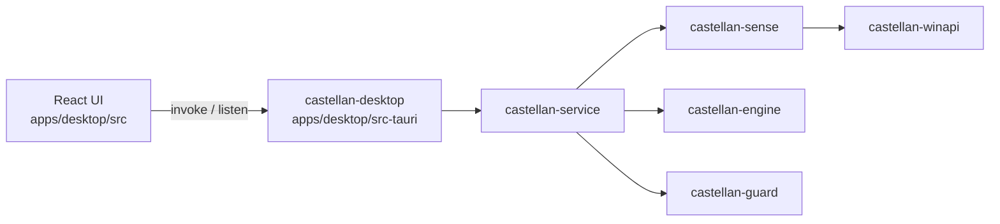

# Desktop architecture

`Castellan.exe` is a Tauri 2 app. The window runs a React frontend in WebView2; the process around it is Rust and talks to the rest of the workspace only through `castellan-service`.



## Files

| Path | Role |
| --- | --- |
| `src-tauri/src/lib.rs` | Builder: plugins, managed `Castellan`, command list, live streams on page load. |
| `src-tauri/src/ipc.rs` | Contract v1: commands, events, error and payload types, and the tests that guard them. |
| `src-tauri/build.rs` | Lists every command so Tauri generates one `allow-*` permission each. |
| `src-tauri/capabilities/main.json` | What the main window may call. Nothing outside Castellan's own commands and event listening. |
| `src-tauri/tauri.conf.json` | Window (Mica, sizes), strict CSP, frozen prototypes, no devtools. |
| `src/ipc/bindings.ts` | Generated from Rust. Do not edit. |
| `src/ipc/client.ts` | Typed wrappers, contract check, error mapping. |

## Contract v1

| Name | Kind | Returns |
| --- | --- | --- |
| `contract_version` | command | `number`; the window refuses to run if it differs from `CONTRACT_VERSION` |
| `about` | command | name, version, author, repository, dev build flag |
| `overview` | command | Keep Score, display band, findings, persona, Windows volume |
| `facts` | command | drives, memory, uptime, logical processors |
| `castellan:pulse` | event | processor, memory, uptime, about once a second |
| `castellan:sweep` | event | one temp folder's read-only measurement |

Every command is read-only and takes no arguments. Commands that change the system arrive in G3 and will accept only a plan id plus a one-time nonce issued by the service.

## Security posture in G0

- CSP: `default-src 'self'`, no inline scripts or styles in release, no remote hosts, `object-src 'none'`, `frame-ancestors 'none'`.
- `freezePrototype`, `withGlobalTauri: false`, devtools off.
- No `shell`, `fs`, `http`, `process`, or `opener` permission. A test fails if the capability grants any of them, or `core:default`.
- ESLint forbids `dangerouslySetInnerHTML`, `innerHTML`, `outerHTML`, `insertAdjacentHTML`, `eval`, and `new Function`.
- `harden_process` restricts DLL loading to System32 before Tauri starts.

The isolation pattern and the WebView section of the threat model come in G2.

## Develop

```powershell
Set-Location <path-to>\castellan\apps\desktop
pnpm install
pnpm tauri dev
```

After changing a type in `castellan_core::live` or `ipc.rs`, refresh the TypeScript types:

```powershell
$env:CASTELLAN_UPDATE_BINDINGS = "1"; cargo test -p castellan-desktop bindings
```
