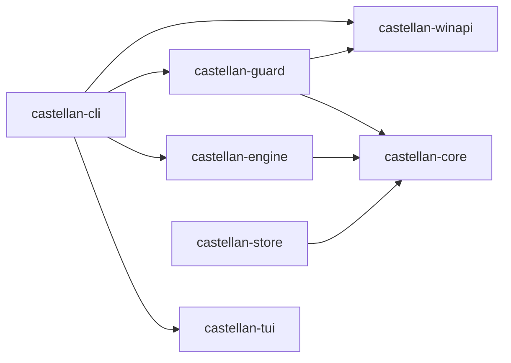

# Architecture

`castellan-core` has no I/O. `castellan-winapi` is the only crate allowed to use `unsafe`. The store is not called by the CLI yet. See [crates.md](crates.md) and [ADR 0002](../adr/0002-architecture.md).
